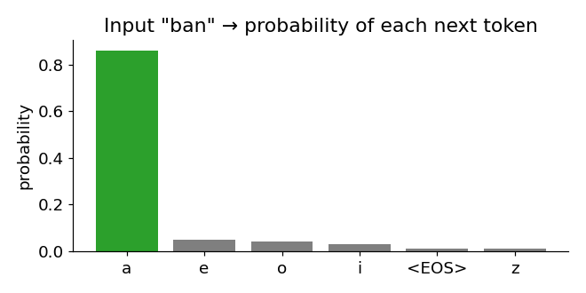
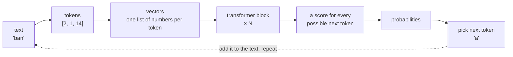
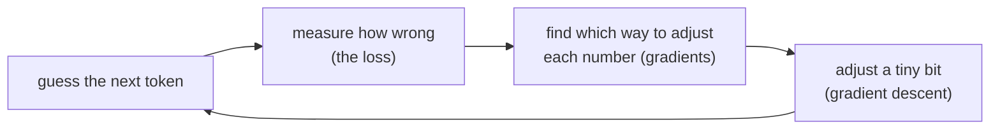

# 00 · What is a transformer?

> In one sentence: a large language model (LLM) is a machine that reads some text and
> **guesses the next piece of text** — and a *transformer* is the design of that machine.

No code in this lesson. Just the big picture we'll build, piece by piece, in the rest of the course.

## 1. An LLM does one thing: guess what comes next

Give it `ban`. It doesn't "know" the word banana. It looks at what it has read so far and
gives a **probability for every possible next piece**:



It picks one (here, probably `a`), sticks it on the end, and asks itself again:

```
ban      → a
bana     → n
banan    → a
banana   → <end>
```

That's it. Chat assistants, code assistants, translators — all of them are this loop,
repeated very fast, with a very big model.

## 2. What happens inside



1. **Tokens** — computers only understand numbers, so we cut text into small pieces and give each piece an id.
2. **Vectors** — each id becomes a list of numbers that describes the token (and its position).
3. **Transformer blocks** — the real work. Each block has two steps:
   - **Attention: tokens talk to each other.** Each token looks at the tokens before it
     and collects what is useful. In `ban`, the `n` might look back at the `b`.
   - **Feed-forward: each token thinks alone.** Each token digests what it collected.

   Stack the block many times, and the understanding gets deeper with every layer.
4. **Scores → probabilities** — compare the final vector to every token in the vocabulary
   and turn those scores into probabilities.

## 3. How does it learn?

At the start, all the numbers inside the model are random, so its guesses are random.
We teach it by showing it lots of text and repeating:



After many rounds the guesses get good. Nobody writes rules like "after `bana` comes `n`" —
the model discovers them by itself, just from being corrected.

## 4. Where each piece is taught

| Piece | Lessons |
|---|---|
| The math tools: numbers in grids, slopes, loss, walking downhill | 01–04 |
| Simple neural networks | 05–07 |
| Turning scores into probabilities and measuring "how wrong" | 08–12 |
| Text → tokens → vectors | 13–15 |
| Attention and the transformer block | 16–21 |
| The full GPT: training it and generating text | 22–25 |

## Check yourself

1. An LLM writes a 100-token answer. How many times did it run the "guess the next token" step?

<details><summary>Answer</summary>

100 times — once per token. That's why long answers take longer.
</details>

<details><summary>Going deeper: why the name "transformer"?</summary>

It comes from the 2017 paper *Attention Is All You Need*, which designed it for translation:
*transforming* a sentence in one language into another. GPT ("Generative Pre-trained Transformer")
keeps only the part that generates text, one token at a time. Before transformers, language
models read text one word after another (RNNs). Attention lets every token look at every earlier token
at once, which trains much faster on modern hardware.
</details>

---
[Course map](../README.md) · Next: [01 · Tensors](01_tensors.md)
