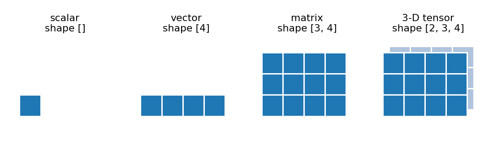

# 01 · Tensors

> In one sentence: a tensor is just numbers arranged in a grid — a single number, a list,
> a table, or a stack of tables — and its **shape** says how many numbers go in each direction.

## The idea



| Name | What it looks like | Shape | Example in an LLM |
|---|---|---|---|
| **scalar** | one number | `[]` | the loss: `2.3` |
| **vector** | a list of numbers | `[4]` | one token described by 4 numbers |
| **matrix** | a table (rows × columns) | `[3, 4]` | a sentence of 3 tokens, 4 numbers each |
| **3-D tensor** | a stack of tables | `[2, 3, 4]` | 2 sentences at once ("a batch") |

"Tensor" is the general word for all of them. The number of directions is the number of **dimensions**.

In this course the shape of the data flowing through GPT is almost always `[B, T, E]`:

| Letter | Meaning |
|---|---|
| `B` | **b**atch: how many texts we process at once |
| `T` | **t**okens per text |
| `E` | **e**mbedding size: how many numbers describe one token |

## The one operation that matters most: the dot product

Multiply two vectors number by number, then add everything up:

```math
a \cdot b = \sum_i a_i b_i
```

```math
[1, 2, 3] \cdot [4, 0, -1] = 1 \cdot 4 + 2 \cdot 0 + 3 \cdot (-1) = 1
```

A big dot product means the two vectors "point the same way" — they are **similar**.
Attention (lesson 16) is built on exactly this.

**Matrix multiplication** is just many dot products at once: every row of the first
matrix with every column of the second.

```math
\begin{bmatrix} 1 & 2 \cr 3 & 4 \end{bmatrix}
\begin{bmatrix} 5 \cr 6 \end{bmatrix}
=
\begin{bmatrix} 1 \cdot 5 + 2 \cdot 6 \cr 3 \cdot 5 + 4 \cdot 6 \end{bmatrix}
=
\begin{bmatrix} 17 \cr 39 \end{bmatrix}
```

## Using PyTorch to hold tensors

We use PyTorch as our calculator: it stores tensors and does the arithmetic fast.

```python
import torch

loss = torch.tensor(2.3)                         # scalar
token = torch.tensor([0.1, -0.5, 0.3, 0.9])      # vector
sentence = torch.zeros(3, 4)                     # matrix: 3 tokens × 4 numbers
batch = torch.randn(2, 3, 4)                     # 3-D: random numbers, shape [B=2, T=3, E=4]

print(loss.shape, token.shape, sentence.shape, batch.shape)
print(batch[0].shape)        # the first sentence: [3, 4]
print(batch[0, 1])           # its second token: a vector of 4 numbers
```

Check the two calculations above:

```python
a = torch.tensor([1.0, 2.0, 3.0])
b = torch.tensor([4.0, 0.0, -1.0])
print(a @ b)                 # dot product: 1.0

M = torch.tensor([[1.0, 2.0], [3.0, 4.0]])
v = torch.tensor([[5.0], [6.0]])
print(M @ v)                 # [[17], [39]]
```

## Check yourself

1. A batch of 8 texts, 10 tokens each, each token described by 32 numbers. What's the shape? How many numbers in total?
2. What is $[1, 0] \cdot [0, 1]$? What does that say about the two vectors?

<details><summary>Answers</summary>

1. `[8, 10, 32]` — $8 \times 10 \times 32 = 2560$ numbers.
2. `0` — they have nothing in common (they point in completely different directions).
</details>

<details><summary>Going deeper: broadcasting</summary>

When two tensors have different shapes, PyTorch repeats the smaller one to fit. We use this to add
the same position vector to every sentence in a batch (lesson 15):

```python
positions = torch.randn(3, 4)          # [T, E]: one vector per position
print((batch + positions).shape)       # [2, 3, 4] + [3, 4] -> [2, 3, 4]
```
</details>

---
[Course map](../README.md) · Prev: [00](00_what_is_a_transformer.md) · Next: [02 · Gradients](02_gradients.md)
