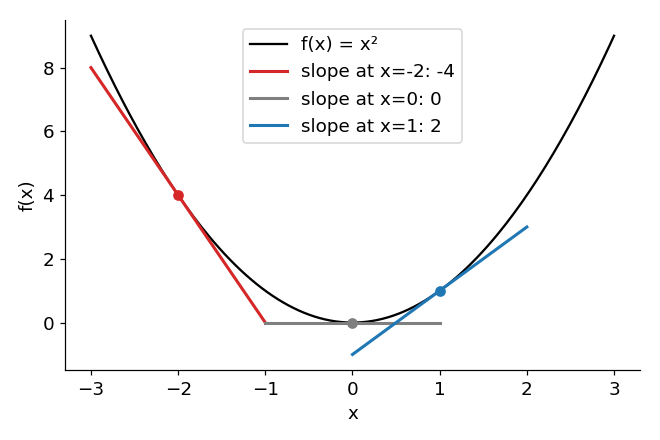

# 02 · Gradients

**Level: 🟢 Basic**

> In one sentence: the gradient tells you how much the output changes when you nudge an input
> a tiny bit — and so, which direction is "downhill".

## The idea: the slope

Take the simplest curve there is: $f(x) = x^2$.



At every point the curve has a **slope** (the straight line that just touches it):

| at $x =$ | slope | meaning |
|---|---|---|
| `-2` | `-4` | going right makes `f` **smaller**, quickly |
| `0` | `0` | flat: we're at the bottom |
| `1` | `2` | going right makes `f` **bigger** |

## Finding the slope by hand

Nudge $x$ by a tiny amount $h$ and see how much $f$ changes:

```math
\text{slope} \approx \frac{f(x + h) - f(x)}{h}
```

At $x = 3$ with $h = 0.001$:

```math
\frac{f(3.001) - f(3)}{0.001} = \frac{9.006001 - 9}{0.001} \approx 6
```

For $x^2$ there is a shortcut rule: **the slope is $2x$**. At $x = 3$ that's $6$ ✓.

```math
f(x) = x^2 \quad \Rightarrow \quad f'(x) = 2x
```

The slope is also called the **derivative**, written $f'(x)$ or $\frac{df}{dx}$. When a function has several
inputs, each input has its own slope, and the list of all of them is the **gradient** $\nabla f$.
Same idea, just more knobs:

```math
\nabla f(w, b) = \left( \frac{\partial f}{\partial w}, \frac{\partial f}{\partial b} \right)
```

## Why we care

The sign of the slope tells us which way is downhill:

- slope **positive** → decrease $x$ to make $f$ smaller
- slope **negative** → increase $x$

A model has millions of knobs (weights). The gradient tells us, for every single one,
which way to turn it to make the model's mistakes smaller (lessons 03–04).

## Letting PyTorch compute it

Computing slopes by hand for millions of weights is impossible. PyTorch can do it for us:
it remembers every calculation, then works backwards to find every slope. We just call `.backward()`.

```python
import torch

x = torch.tensor(3.0, requires_grad=True)   # "x is a knob: please track its slope"
f = x ** 2
f.backward()                                 # compute the slope of f for every knob
print(x.grad)                                # tensor(6.) — same as 2x
```

Check the "nudge" method gives the same answer:

```python
def f(x): return x ** 2
h = 0.001
print((f(3 + h) - f(3)) / h)                 # ≈ 6.001
```

It works for any formula, however long — including a whole GPT:

```python
w = torch.tensor(2.0, requires_grad=True)
b = torch.tensor(1.0, requires_grad=True)
y = (w * 3 + b) ** 2                          # a function of two knobs
y.backward()
print(w.grad, b.grad)                         # tensor(42.) tensor(14.)
```

## Check yourself

1. What is the slope of $x^2$ at $x = -5$? Which way should $x$ move to make $x^2$ smaller?

<details><summary>Answer</summary>

$2 \cdot (-5) = -10$. Negative, so move $x$ to the right (increase it) — towards 0, the bottom.
</details>

<details><summary>Going deeper: the chain rule</summary>

How did PyTorch get `42` above? Write $y = u^2$ where $u = 3w + b = 7$.
The slope of $y$ with respect to $u$ is $2u = 14$; the slope of $u$ with respect to $w$ is $3$.
Chain them by multiplying:

```math
\frac{\partial y}{\partial w} = \frac{dy}{du} \cdot \frac{\partial u}{\partial w} = 14 \cdot 3 = 42,
\qquad
\frac{\partial y}{\partial b} = \frac{dy}{du} \cdot \frac{\partial u}{\partial b} = 14 \cdot 1 = 14
```

PyTorch does exactly this, step by step, backwards through every operation — that's why it's called
**back**propagation.
</details>

---
[Course map](../README.md) · Prev: [01](01_tensors.md) · Next: [03 · Loss](03_loss.md)
