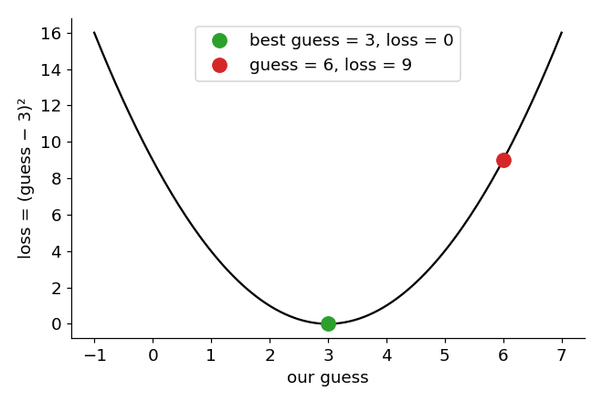

# 03 · Loss

> In one sentence: the loss is a single number that says **how wrong** the model is —
> so learning means finding the settings that make the loss as small as possible.

## The idea

Imagine a game: I hide the number `3`, you guess. To score your guess, square the error:

```
loss = (guess − 3)²
```

| guess | loss |
|---|---|
| 6 | 9 |
| 4 | 1 |
| 3 | **0** — perfect |



Three things to notice:

1. **Smaller is better**, and `0` means perfect. So we want the **minimum** of the loss.
2. The curve is a bowl — the same shape as `x²` from lesson 02. We already know how to find which way is downhill: the slope!
3. The loss is **one number**, no matter how big the model is. That gives us a single, clear goal.

## From one guess to many

A model makes many predictions (one per example). We take the **average** of all the squared errors.
This is called the **Mean Squared Error (MSE)**:

```
predictions:  [2.5, 0.0, 2.0]
targets:      [3.0, -0.5, 2.0]
errors²:      [0.25, 0.25, 0.0]       → average = 0.1667
```

## Code

[`modules/loss.py`](../modules/loss.py):

```python
import torch

def mse(prediction, target):
    return ((prediction - target) ** 2).mean()
```

## Try it

```python
print(mse(torch.tensor([2.5, 0.0, 2.0]), torch.tensor([3.0, -0.5, 2.0])))   # 0.1667
```

The loss tells us *how* wrong; the gradient (lesson 02) tells us *which way to change the guess*:

```python
guess = torch.tensor(6.0, requires_grad=True)
loss = mse(guess, torch.tensor(3.0))
loss.backward()
print(loss.item(), guess.grad.item())       # 9.0, 6.0 → positive slope, so guess should go down
```

## Check yourself

1. Two models: one has loss `0.8`, the other `0.2`. Which one is better?
2. Why square the error instead of just using `guess − 3`?

<details><summary>Answers</summary>

1. The one with `0.2` — less wrong.
2. `guess − 3` can be negative. A guess of `0` would get `−3`, which looks "better" than a perfect `0`.
   Squaring makes every error positive, so the smallest loss really is the best guess.
</details>

<details><summary>Going deeper: other losses</summary>

- **Mean Absolute Error** `|guess − 3|` also works, but punishes big mistakes less, and its slope
  jumps suddenly at the minimum.
- MSE is for predicting **numbers**. An LLM picks a **token out of many**, which needs a different loss:
  **cross-entropy** (lesson 09). The idea is the same: one number, smaller is better.
</details>

---
[Course map](../README.md) · Prev: [02](02_gradients.md) · Next: [04 · Gradient descent](04_gradient_descent.md)
