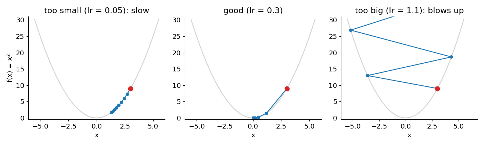

# 04 · Gradient descent

> In one sentence: to find the minimum of the loss, repeatedly take a small step in the
> downhill direction that the gradient points to.

## The idea

You're on a hill in thick fog and want to reach the bottom. You can't see the valley,
but you can feel which way the ground slopes under your feet. So: take a small step downhill,
feel again, step again. That's **gradient descent**.

```
new x = x − learning_rate × slope
```

- the **minus** sign: the slope points uphill, we go the other way
- the **learning rate** (`lr`): how big a step to take

## By hand

Minimise `f(x) = x²` (slope `2x`), starting at `x = 3` with `lr = 0.3`:

| step | x | slope `2x` | new x = x − 0.3 × slope |
|---|---|---|---|
| 1 | 3.0 | 6.0 | 1.2 |
| 2 | 1.2 | 2.4 | 0.48 |
| 3 | 0.48 | 0.96 | 0.19 |

We're closing in on `0`, the bottom. Steps get smaller by themselves, because the slope gets flatter.

## Choosing the learning rate



- **too small**: we get there, but very slowly
- **good**: we reach the bottom in a few steps
- **too big**: we jump over the bottom, further every time, and the loss explodes

## Code

[`modules/optim.py`](../modules/optim.py) — an "optimizer" is the thing that updates the knobs:

```python
import torch

class SGD:
    def __init__(self, params, lr):
        self.params = list(params)
        self.lr = lr

    def zero_grad(self):
        for p in self.params:
            p.grad = None                  # forget the old slopes

    def step(self):
        with torch.no_grad():              # the update itself is not part of the model's math
            for p in self.params:
                p -= self.lr * p.grad      # new x = x − lr × slope
```

## Try it

First, the table above:

```python
x = torch.tensor(3.0, requires_grad=True)
opt = SGD([x], lr=0.3)
for step in range(3):
    opt.zero_grad()
    f = x ** 2
    f.backward()                           # slope
    opt.step()                             # step downhill
    print(step + 1, round(x.item(), 2))    # 1.2, 0.48, 0.19
```

Now the real thing — **learning from data**. We have points that follow `y = 2x`, but the model
doesn't know the `2`. It starts with a guess `w = 0` and learns it by minimising the [loss](03_loss.md):

```python
from modules.loss import mse

xs = torch.tensor([1.0, 2.0, 3.0, 4.0])
ys = torch.tensor([2.0, 4.0, 6.0, 8.0])

w = torch.tensor(0.0, requires_grad=True)
opt = SGD([w], lr=0.02)
for step in range(30):
    loss = mse(w * xs, ys)                 # 1. predict and measure how wrong
    opt.zero_grad()
    loss.backward()                        # 2. slope of the loss for w
    opt.step()                             # 3. step downhill
print(round(w.item(), 3))                  # ≈ 2.0 — it found the rule!
```

**This loop is how every neural network learns, including GPT.** The only differences are a
bigger model (millions of `w`s instead of one) and a different loss.

## Check yourself

1. At `x = 3` the slope of `x²` is `6`. With `lr = 1.0`, where do you land? Is that good?

<details><summary>Answer</summary>

`3 − 1.0 × 6 = −3`. You jumped right over the bottom to the same height on the other side — and you'll
keep bouncing between 3 and −3 forever. The learning rate is too big.
</details>

<details><summary>Going deeper: "stochastic", and getting stuck</summary>

- **Stochastic** gradient descent (the "S" in SGD): with lots of data, computing the loss on *all* of it
  for every step is too slow. So each step uses a small random **batch**. The slope is a bit noisy,
  but it's much faster, and works.
- Real loss surfaces aren't a perfect bowl. They have flat areas and small dips. Smarter optimizers
  like **Adam** (lesson 11) help move through them faster.
</details>

---
[Course map](../README.md) · Prev: [03](03_loss.md) · Next: [05 · Linear layer](05_linear_layer.md)
