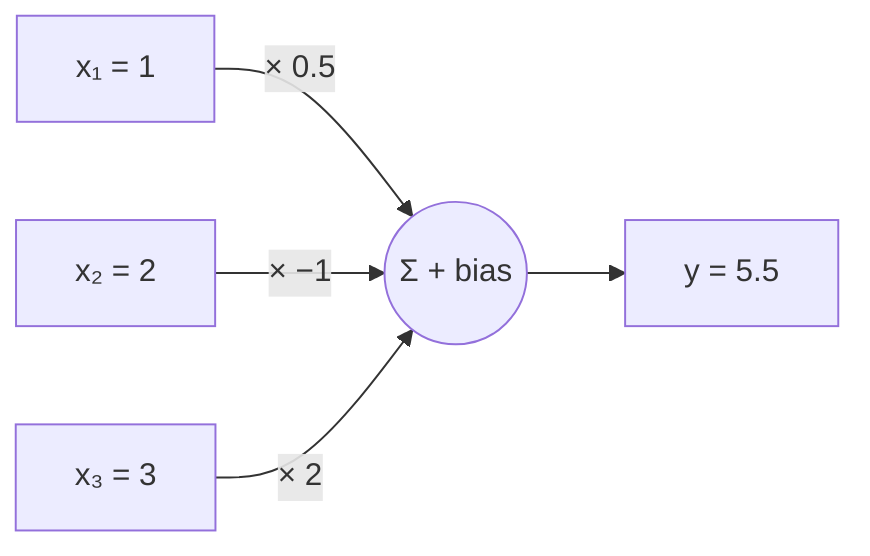

# 05 · Linear layer

**Level: 🟢 Basic**

> In one sentence: a neuron multiplies each input by a weight, adds them up, and adds a bias —
> and a linear layer is many neurons side by side.

## The idea: one neuron



```math
y = \underbrace{0.5 \cdot 1 + (-1) \cdot 2 + 2 \cdot 3}_{\text{weights} \times \text{inputs}} + \underbrace{1}_{\text{bias}} = 5.5
```

In general, for inputs $x_i$, weights $w_i$ and bias $b$:

```math
y = \sum_i w_i x_i + b
```

Each **weight** says how much the neuron cares about each input (negative = "this input pushes me down").
The **bias** is a starting value. This is just the [dot product](01_tensors.md) of the inputs
and the weights, plus a number.

## Many neurons = a layer

A layer with 2 neurons has 2 rows of weights. Computing all neurons at once is exactly a
**matrix multiplication**:

```
inputs [3]  ×  weights [3 → 2]  +  bias [2]  =  outputs [2]
```

Written as a formula:

```math
\mathbf{y} = \mathbf{x} W^\top + \mathbf{b}
```

The weights $W$ and the bias $\mathbf{b}$ are the knobs that
[gradient descent](04_gradient_descent.md) turns. Almost every learnable part of a transformer is a layer like this.

## Code

The math, in [`modules/function.py`](../modules/function.py):

```python
import torch

def linear(x, weight, bias=None):
    # x: [..., in], weight: [out, in], bias: [out]  ->  [..., out]
    out = x @ weight.T
    return out + bias if bias is not None else out
```

Check the neuron above:

```python
x = torch.tensor([1.0, 2.0, 3.0])
W = torch.tensor([[0.5, -1.0, 2.0]])     # 1 neuron
b = torch.tensor([1.0])
print(linear(x, W, b))                   # tensor([5.5])
```

A layer also has to **keep** its weights, so we wrap the function in a class.
Simplified from `Linear` in [`modules/module.py`](../modules/module.py):

```python
import math
from modules.module import Module, Parameter

class MyLinear(Module):
    def __init__(self, in_features, out_features):
        # start with small random weights; gradient descent improves them
        self.W = Parameter(torch.randn(out_features, in_features) / math.sqrt(in_features))
        self.b = Parameter(torch.zeros(out_features))

    def _param_keys(self): return 'W', 'b'
    def _config_keys(self): return self._param_keys()
    def forward(self, x): return linear(x, self.W, self.b)
```

A `Parameter` is a tensor marked as "a knob to learn" (it tracks its gradient).

## Try it

```python
layer = MyLinear(3, 2)                   # 3 inputs -> 2 neurons
print(layer(x))                          # 2 outputs (random for now)
print([name for name, _ in layer.named_parameters()])   # ['W', 'b']
```

## Check yourself

1. How many learnable numbers does a layer from 512 inputs to 2048 outputs have?

<details><summary>Answer</summary>

$512 \times 2048$ weights $+ 2048$ biases $= 1{,}050{,}624$.
</details>

<details><summary>Going deeper: why divide the starting weights by <code>√in_features</code>?</summary>

Each output adds up $n$ = `in_features` random products. Adding up $n$ random numbers gives a result about
$\sqrt{n}$ times bigger. Stack a few layers and the numbers explode, and training goes badly.
Dividing the weights by $\sqrt{n}$ keeps outputs at about the same size as the inputs:

```python
x = torch.randn(1000, 512)
print((x @ torch.randn(512, 512)).std().item())                     # ≈ 22.6 (= √512)
print((x @ (torch.randn(512, 512) / math.sqrt(512))).std().item())  # ≈ 1.0
```
</details>

---
[Course map](../README.md) · Prev: [04](04_gradient_descent.md) · Next: [06 · Activations](06_activations.md)
