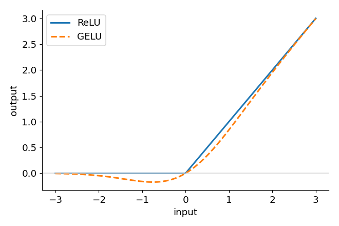

# 06 · Activation functions

> In one sentence: an activation is a simple bend applied to every number, so that stacked
> layers can learn curved patterns instead of only straight lines.

## The idea

A [linear layer](05_linear_layer.md) can only draw straight lines. Worse: two linear layers in a
row are *still* just one straight line — multiplying by 2 and then by 3 is the same as multiplying by 6.
Stacking them gains nothing:

```math
(x W_1) W_2 = x (W_1 W_2) = x W
```

The fix is to **bend** the numbers between layers with a simple function:



- **ReLU** — keep positive numbers, turn negative ones into 0. The simplest bend:

```math
\text{ReLU}(x) = \max(0, x)
```

- **GELU** — a smooth version of ReLU. GPT uses this one. It multiplies $x$ by $\Phi(x)$,
  the chance that a random normal number is below $x$ (close to 0 for very negative $x$, close to 1 for very positive $x$):

```math
\text{GELU}(x) = x \cdot \Phi(x)
```

With a bend between them, stacked layers can combine many small bends into any curved shape they need.

## By hand

```
x       = [-3,  -1,  0,  1,  3]
ReLU(x) = [ 0,   0,  0,  1,  3]
```

## Code

```python
import math
import torch

def relu(x):
    return torch.clamp(x, min=0)

def gelu(x):
    # x times "the chance a random normal number is below x"
    return x * 0.5 * (1.0 + torch.erf(x / math.sqrt(2.0)))
```

`gelu` is in [`modules/function.py`](../modules/function.py).

## Try it

```python
x = torch.tensor([-3.0, -1.0, 0.0, 1.0, 3.0])
print(relu(x))   # [0, 0, 0, 1, 3]
print(gelu(x))   # ≈ [-0.004, -0.159, 0, 0.841, 2.996]
```

See for yourself that two linear layers collapse into one, but not with a bend in between:

```python
W1, W2 = torch.randn(4, 4), torch.randn(4, 4)
v = torch.randn(4)
print(torch.allclose((v @ W1) @ W2, v @ (W1 @ W2), atol=1e-5))      # True: just one linear layer
print(torch.allclose(gelu(v @ W1) @ W2, v @ (W1 @ W2), atol=1e-5))  # False: GELU adds something new
```

## Check yourself

1. What is the slope of ReLU at $x = -2$? Why might that be a problem for [gradient descent](04_gradient_descent.md)?

<details><summary>Answer</summary>

0 — it's flat there. With a slope of 0, gradient descent doesn't know which way to move, so a neuron that only
ever sees negative inputs stops learning ("dead ReLU"). GELU's slope there is small, but not exactly 0.
</details>

<details><summary>Going deeper: the tanh approximation</summary>

The original GPT-2 code used a faster formula, which differs from exact GELU by less than 0.001:

```math
\text{GELU}(x) \approx 0.5 x \left( 1 + \tanh\left( \sqrt{2/\pi} \left( x + 0.044715 x^3 \right) \right) \right)
```

```python
approx = 0.5 * x * (1 + torch.tanh(math.sqrt(2 / math.pi) * (x + 0.044715 * x ** 3)))
print((approx - gelu(x)).abs().max().item() < 1e-3)   # True
```
</details>

---
[Course map](../README.md) · Prev: [05](05_linear_layer.md) · Next: [08 · Softmax](08_softmax.md)
*(lesson 07 is coming soon)*
