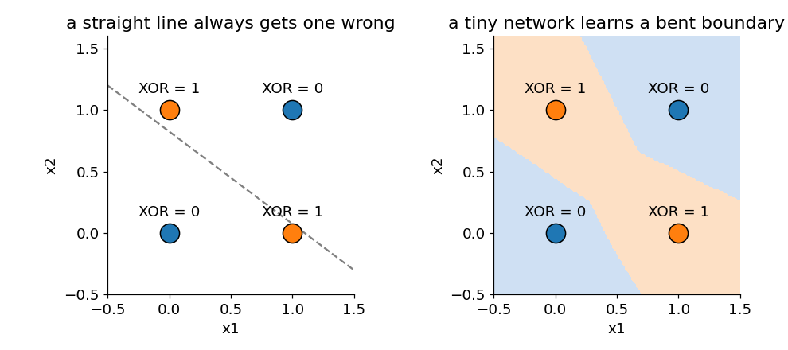
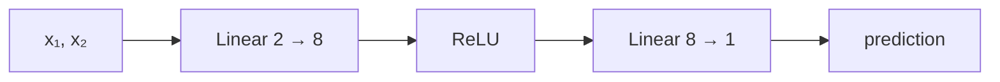

# 07 · Your first neural network

**Level: 🟢 Basic**

> In one sentence: stack two linear layers with a bend (activation) between them, train them
> with gradient descent, and they can learn a pattern no single straight line can.

## The idea

**XOR** ("exclusive or") answers 1 when exactly one of two inputs is 1:

| $x_1$ | $x_2$ | XOR |
|---|---|---|
| 0 | 0 | 0 |
| 0 | 1 | 1 |
| 1 | 0 | 1 |
| 1 | 1 | 0 |

Put the four points on a plane (left). Try to draw **one straight line** with all the 1s on one
side and all the 0s on the other — it's impossible. A single [linear layer](05_linear_layer.md) can only draw
straight lines, so it can never learn XOR.



Add a **hidden layer** with an [activation](06_activations.md) in between, and the network can bend its
boundary (right). That's a neural network:



```math
h = \text{ReLU}(x W_1^\top + b_1), \qquad \hat{y} = h W_2^\top + b_2
```

Training is exactly the loop from [lesson 04](04_gradient_descent.md): predict, measure the [loss](03_loss.md),
compute gradients, step downhill. Nothing new — just more knobs.

## Code

[`models/mlp/xor.py`](../models/mlp/xor.py):

```python
import torch
from modules.module import Module, Linear
from modules.function import relu
from modules.loss import mse
from modules.optim import SGD

X = torch.tensor([[0., 0.], [0., 1.], [1., 0.], [1., 1.]])   # the 4 inputs
Y = torch.tensor([[0.], [1.], [1.], [0.]])                   # the 4 answers

class XorNet(Module):
    def __init__(self, hidden=8):
        self.fc1 = Linear(2, hidden)
        self.fc2 = Linear(hidden, 1)

    def _param_keys(self): return 'fc1', 'fc2'
    def _config_keys(self): return self._param_keys()
    def forward(self, x): return self.fc2(relu(self.fc1(x)))
```

## Try it

```python
torch.manual_seed(0)
model = XorNet()
optimizer = SGD(model.parameters(), lr=0.1)
for step in range(500):
    loss = mse(model(X), Y)          # 1. predict and measure how wrong
    optimizer.zero_grad()
    loss.backward()                  # 2. slopes for all 33 knobs
    optimizer.step()                 # 3. step downhill
print(round(loss.item(), 4))                                # ≈ 0.0
print(model(X).detach().round(decimals=2).squeeze())        # ≈ [0, 1, 1, 0]
```

Now the same training with **only one linear layer** — no hidden layer, no bend:

```python
torch.manual_seed(0)
line = Linear(2, 1)
optimizer = SGD(line.parameters(), lr=0.1)
for step in range(500):
    loss = mse(line(X), Y)
    optimizer.zero_grad()
    loss.backward()
    optimizer.step()
print(round(loss.item(), 4))                                # 0.25 — stuck
print(line(X).detach().round(decimals=2).squeeze())         # ≈ [0.5, 0.5, 0.5, 0.5]: it gives up and guesses 0.5
```

## Check yourself

1. How many learnable numbers does `XorNet()` have?
2. What happens if you remove `relu` from `forward`?

<details><summary>Answers</summary>

1. `fc1`: $2 \times 8 + 8 = 24$, `fc2`: $8 \times 1 + 1 = 9$, total $33$.
   Check it yourself: `sum(p.numel() for p in model.parameters())`.
2. Two linear layers in a row are just one linear layer ([lesson 06](06_activations.md)), so it fails like `line` does.
</details>

<details><summary>Going deeper: how big must a network be?</summary>

In theory, one hidden layer with enough neurons can approximate *any* reasonable function
(the "universal approximation theorem"). In practice, bigger and deeper networks are much easier
to train: XOR can be solved with just 2 hidden neurons, but training then often gets stuck. With 8 it works reliably.
</details>

---
[Course map](../README.md) · Prev: [06](06_activations.md) · Next: [08 · Softmax](08_softmax.md)
