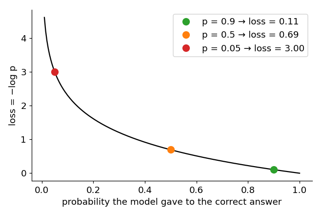

# 09 · Cross-entropy loss

> In one sentence: when a model picks one answer out of many, its loss is $-\log$ of the
> probability it gave to the correct answer — confident and right is cheap, confident and wrong is expensive.

## The idea

An LLM doesn't output one number; it outputs a probability for **every** token ([softmax](08_softmax.md)).
[MSE](03_loss.md) doesn't fit here. We need a loss that is:

- **0** when the model gives the correct answer probability 1
- **huge** when it gives the correct answer probability close to 0

$-\log p$ does exactly that:



```math
\text{loss} = -\log p_{\text{correct}}
```

Averaged over $N$ examples, where $y_n$ is the correct class of example $n$:

```math
\text{CE} = -\frac{1}{N} \sum_{n=1}^{N} \log p_{n, y_n}
```

## By hand

The model says: `a` 0.7, `b` 0.2, `c` 0.1.

| correct answer | $p_{\text{correct}}$ | loss $= -\log p$ |
|---|---|---|
| `a` | 0.7 | 0.36 — good guess, small loss |
| `c` | 0.1 | 2.30 — bad guess, big loss |

Only the probability of the **correct** answer matters. But because softmax makes all probabilities share a
total of 1, pushing the correct one up automatically pushes the others down.

## Computing it safely: log-softmax

The model outputs raw scores (logits) $z$. We could compute softmax, then take the log — but tiny
probabilities round to 0, and $\log 0 = -\infty$. Combining the two steps avoids that:

```math
\log \text{softmax}(z)_i = \log \frac{e^{z_i}}{\sum_j e^{z_j}} = z_i - \log \sum_j e^{z_j}
```

## Code

[`modules/function.py`](../modules/function.py) and [`modules/loss.py`](../modules/loss.py), simplified:

```python
import torch

def log_softmax(z):
    z = z - z.max(dim=-1, keepdim=True).values                  # same trick as softmax
    return z - torch.log(torch.exp(z).sum(dim=-1, keepdim=True))

def cross_entropy(logits, targets, ignore_index=None):
    log_probs = log_softmax(logits)                              # [N, C]
    loss = -log_probs[torch.arange(len(targets)), targets]       # [N]: -log p(correct)
    if ignore_index is not None:
        loss = loss[targets != ignore_index]                     # skip padding
    return loss.mean()
```

## Try it

The table above (we take the log of the probabilities as logits, so softmax gives back exactly 0.7, 0.2, 0.1):

```python
logits = torch.log(torch.tensor([[0.7, 0.2, 0.1]]))
print(cross_entropy(logits, torch.tensor([0])).item())    # 0.357  (correct = a)
print(cross_entropy(logits, torch.tensor([2])).item())    # 2.303  (correct = c)
```

A model that knows nothing gives every one of $V$ tokens the same probability $\frac{1}{V}$, so its loss is $\ln V$:

```python
import math
V = 87
print(cross_entropy(torch.zeros(1, V), torch.tensor([5])).item(), math.log(V))   # both 4.466
```

That's why our GPT's training starts at a loss of about 4.47 ([lesson 23](23_next_token_training.md)).

## Check yourself

1. The loss of one prediction is 0.69. What probability did the model give to the correct answer?

<details><summary>Answer</summary>

$p = e^{-0.69} \approx 0.5$.
</details>

<details><summary>Going deeper: label smoothing, and the name</summary>

**Label smoothing.** Cross-entropy is only 0 at $p = 1$, so it keeps pushing the model to be 100% sure.
Label smoothing gives a small share $\varepsilon$ (e.g. 0.1) of the credit to *every* class $c$ out of $C$, so
the model is happy to stay a little humble:

```math
\text{loss} = (1 - \varepsilon) \left( -\log p_{y} \right) + \varepsilon \cdot \frac{1}{C} \sum_{c=1}^{C} \left( -\log p_c \right)
```

```python
from modules.loss import cross_entropy as ce
print(ce(logits, torch.tensor([0]), label_smoothing=0.1).item())   # a bit higher than 0.357
```

**The name.** In information theory, $-\log p$ is the "surprise" of seeing an event of probability $p$.
Cross-entropy is the average surprise of the model when it sees the real answers.
</details>

---
[Course map](../README.md) · Prev: [08](08_softmax.md) · Next: [10 · Metrics](10_metrics.md)
