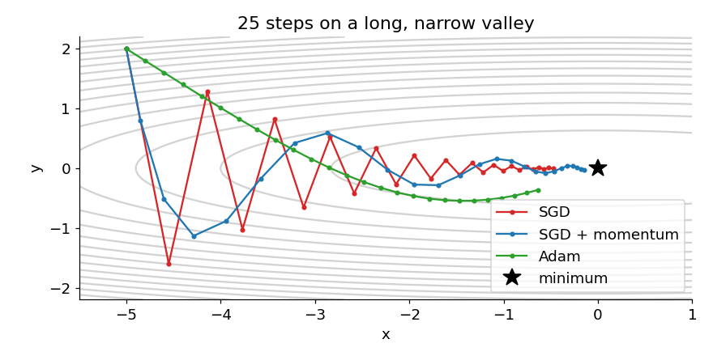

# 11 · Momentum and Adam

> In one sentence: instead of stepping exactly along today's slope, **momentum** keeps rolling in the
> direction it has been going, and **Adam** also gives every knob its own step size.

## The idea: why plain gradient descent struggles

Real loss surfaces are often long, narrow valleys: steep across, gently sloped along. Plain
[gradient descent](04_gradient_descent.md) uses one learning rate for everything, so it bounces between
the steep walls while crawling along the valley floor (red):



### Momentum: a heavy ball

A heavy ball rolling downhill doesn't change direction at every bump — it keeps its speed.
We keep a **velocity** $v$: a running sum of past slopes $g$. Zigzags cancel out; steady directions add up (blue).

```math
v \leftarrow \mu \, v + g, \qquad w \leftarrow w - \eta \, v
```

$\mu$ (e.g. 0.9) is how much of the old velocity we keep.

**By hand**, with the same slope $g = 1$ every step and $\mu = 0.9$: $v = 1$, then $1.9$, then $2.71$, ... up to $10$.
On a steady slope the ball speeds up to $\frac{1}{1 - \mu} = 10$ times the plain step.

### Adam: momentum + a step size per knob

Some knobs get huge slopes, others tiny ones. Adam keeps **two** running averages for every knob:

- $m$: average slope — *which way* to go (like momentum)
- $s$: average **squared** slope — *how big* the slopes of this knob usually are

and divides one by the square root of the other:

```math
m \leftarrow \beta_1 m + (1 - \beta_1) \, g, \qquad
s \leftarrow \beta_2 s + (1 - \beta_2) \, g^2, \qquad
w \leftarrow w - \eta \, \frac{m}{\sqrt{s} + \epsilon}
```

Because $\frac{m}{\sqrt{s}}$ is "slope divided by its usual size", every knob moves about $\eta$ per step,
whether its slopes are 100 or 0.01. On the valley above (green), that means even-sized steps in both
directions — no zigzag. Typical values: $\beta_1 = 0.9$, $\beta_2 = 0.999$, $\epsilon = 10^{-8}$.
**Adam is the default optimizer for training transformers.**

## Code

`Adam.step` from [`modules/optim.py`](../modules/optim.py), for one knob `p`:

```python
import torch

def adam_update(p, m, s, t, lr=1e-3, beta1=0.9, beta2=0.999, eps=1e-8):
    g = p.grad
    m = beta1 * m + (1 - beta1) * g
    s = beta2 * s + (1 - beta2) * g * g
    m_hat = m / (1 - beta1 ** t)                # bias correction, see Going deeper
    s_hat = s / (1 - beta2 ** t)
    with torch.no_grad():
        p -= lr * m_hat / (torch.sqrt(s_hat) + eps)
    return m, s
```

## Try it

Adam doesn't care how big the slopes are. Two knobs, one with a 10,000× steeper loss, both move by the same amount:

```python
from modules.optim import SGD, Adam

for Optimizer in (SGD, Adam):
    w = torch.tensor([1.0, 1.0], requires_grad=True)
    opt = Optimizer([w], lr=0.01)
    loss = 100 * w[0] + 0.01 * w[1]          # slopes: 100 and 0.01
    loss.backward()
    opt.step()
    print(Optimizer.__name__, (1 - w.detach()).tolist())   # how far each knob moved
# SGD  [1.0, 0.0001]  — one knob jumps far, the other barely moves
# Adam [0.01, 0.01]   — both move by lr
```

## Check yourself

1. With momentum $\mu = 0.9$, the slopes alternate $+1, -1, +1, -1, \dots$ What happens to the velocity?

<details><summary>Answer</summary>

It stays small: $1, -0.1, 0.91, -0.18, \dots$ — opposite slopes cancel. That's exactly how momentum damps zigzags.
</details>

<details><summary>Going deeper: bias correction and AdamW</summary>

**Bias correction.** $m$ and $s$ start at 0. After the first step, $m = (1 - \beta_1) g = 0.1 g$ — ten times too small.
Dividing by $1 - \beta_1^t$ (here $1 - 0.9 = 0.1$) fixes that. As $t$ grows, $\beta_1^t \to 0$ and the correction fades away.

**AdamW** adds *weight decay*: every step, also shrink every weight a little towards 0, which keeps weights from
growing without need. The "W" means it's done separately from the Adam step (an earlier version mixed it into
the slopes, where Adam's scaling weakened it). Our GPT is trained with AdamW:

```math
w \leftarrow w - \eta \lambda w \quad \text{(then the usual Adam step)}
```

```python
from modules.optim import AdamW
w = torch.tensor([5.0], requires_grad=True)
opt = AdamW([w], lr=0.1, weight_decay=0.1)
(0 * w).sum().backward()                     # zero slope: only weight decay acts
opt.step()
print(w.item())                              # 4.95 = 5 - 0.1 * 0.1 * 5
```
</details>

---
[Course map](../README.md) · Prev: [10](10_metrics.md) · Next: [12 · Training tricks](12_training_tricks.md)
