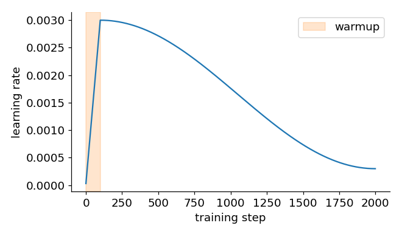

# 12 · Training tricks

> In one sentence: three small tricks that make training more stable — change the learning rate over
> time, cap giant gradients, and randomly switch off neurons.

```python
import math
import torch
```

## 1. Learning-rate schedule: warmup, then cosine decay

**The idea.** At the start, the weights are random and the gradients are wild — big steps can throw the
model somewhere bad. Near the end, we're close to a minimum — big steps make us bounce around it.
So we change the learning rate $\eta$ during training:

1. **warmup**: grow $\eta$ from almost 0 to its maximum over the first few steps
2. **cosine decay**: then glide it smoothly down to a small minimum



For step $t$, with $W$ warmup steps and $T$ total steps:

```math
\eta_t =
\begin{cases}
\eta_{\max} \cdot \dfrac{t + 1}{W} & t < W \cr
\eta_{\min} + \dfrac{1}{2} (\eta_{\max} - \eta_{\min}) \left( 1 + \cos\left( \pi \dfrac{t - W}{T - W} \right) \right) & t \ge W
\end{cases}
```

```python
from modules.optim import warmup_cosine_lr

for step in [0, 50, 99, 100, 1050, 1999]:
    print(step, round(warmup_cosine_lr(step, max_lr=3e-3, warmup_steps=100, total_steps=2000, min_lr=3e-4), 5))
# 0 3e-05 · 50 0.00153 · 99 0.003 · 100 0.003 · 1050 0.00165 · 1999 0.0003
```

In the training loop, we just set `optimizer.lr` before each step.

## 2. Gradient clipping

**The idea.** Once in a while, one unlucky batch produces a gigantic gradient, and a single step undoes
hours of training. Clipping puts a cap on the **length** of the gradient (all knobs together), but keeps its direction:

```math
\|g\| = \sqrt{\sum_i g_i^2}, \qquad
g \leftarrow g \cdot \frac{c}{\|g\|} \quad \text{if } \|g\| > c
```

**By hand**: $g = [3, 4]$ has length $\sqrt{9 + 16} = 5$. Clip to $c = 1$: $g = [0.6, 0.8]$ — same direction, length 1.

```python
from modules.optim import clip_grad_norm

w = torch.tensor([0.0, 0.0], requires_grad=True)
(3 * w[0] + 4 * w[1]).backward()             # gradient = [3, 4]
print(clip_grad_norm([w], max_norm=1.0))     # 5.0 — the length before clipping
print(w.grad)                                # tensor([0.6000, 0.8000])
```

## 3. Dropout

**The idea.** A big network can *memorise* its training data instead of learning the general pattern
("overfitting"). Dropout fights this: during training, randomly set a fraction $p$ of the numbers to 0,
so no neuron can rely on any single other neuron. To keep the average the same, the survivors are scaled up:

```math
\text{dropout}(x)_i =
\begin{cases}
0 & \text{with probability } p \cr
\dfrac{x_i}{1 - p} & \text{otherwise}
\end{cases}
```

When *using* the model, dropout is switched off.

```python
from modules.function import dropout

torch.manual_seed(0)
x = torch.ones(10)
print(dropout(x, p=0.5))                    # about half are 0, the rest are 2.0
print(dropout(x, p=0.5, training=False))    # unchanged
```

Our tiny GPT doesn't use dropout: it has fewer than 32,000 weights and a word list, so there's little to over-memorise.
GPT-2 applied it after attention and after the feed-forward layer.

## Check yourself

1. Why scale by $\frac{1}{1-p}$ instead of just dropping?

<details><summary>Answer</summary>

Without it, the next layer would see values that are on average $(1-p)$ times smaller during training than when
dropout is switched off, so it would behave differently at test time. Scaling keeps the average the same.
</details>

<details><summary>Going deeper: why warmup helps Adam in particular</summary>

Adam divides by $\sqrt{s}$, the running average of squared slopes. In the first few steps, $s$ is estimated
from very few gradients and can be badly off, so Adam's steps can be erratic. A small learning rate during
warmup keeps those early steps harmless until the averages settle.
</details>

---
[Course map](../README.md) · Prev: [11](11_momentum_and_adam.md) · Next: [13 · Tokenizer](13_tokenizer.md)
