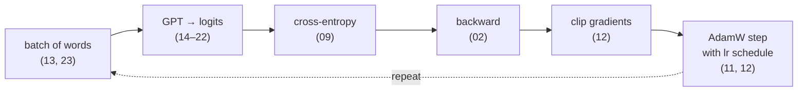

# 25 · Training it end to end

> In one sentence: every piece from this course in one loop — and how to read the numbers it prints.

## The idea

Training our GPT is the same loop as the [XOR network](07_first_neural_network.md), with the bigger pieces swapped in:



Every line of it is our own code; PyTorch only stores the numbers and computes the slopes.

## Code

The heart of `train` in [`models/example/train.py`](../models/example/train.py):

```python
import torch
from models.example.model import MyGPT
from models.example.train import get_train_batch
from modules.loss import cross_entropy
from modules.optim import AdamW, warmup_cosine_lr, clip_grad_norm
from modules.metrics import accuracy, perplexity

def train(steps=600, max_lr=3e-3, warmup_steps=100):
    torch.manual_seed(0)
    model = MyGPT(max_seq_length=100, embed_dim=32, num_layers=2, num_heads=2)
    optimizer = AdamW(model.parameters(), lr=max_lr, weight_decay=0.01)
    for step in range(steps):
        optimizer.lr = warmup_cosine_lr(step, max_lr, warmup_steps, steps, min_lr=max_lr / 10)
        inputs, targets = get_train_batch(model.tokenizer, batch_size=8)
        logits = model(inputs).reshape(-1, model.vocab_size)          # [B*T, V]
        targets = targets.reshape(-1)                                 # [B*T]
        loss = cross_entropy(logits, targets, ignore_index=0)
        optimizer.zero_grad()
        loss.backward()
        clip_grad_norm(model.parameters(), 1.0)
        optimizer.step()
        if step % 150 == 0:
            print(f'step {step:3d} | lr {optimizer.lr:.4f} | loss {loss.item():.3f} '
                  f'| perplexity {perplexity(loss.item()):5.2f} | accuracy {accuracy(logits, targets, 0):.2f}')
    return model
```

## Try it

```python
import random
random.seed(0)
model = train()
```

How to read the log:

| column | at the start | what to watch for |
|---|---|---|
| `lr` | tiny, growing | the warmup and cosine schedule from [lesson 12](12_training_tricks.md) |
| `loss` | $\approx \ln 87 = 4.47$ | should drop fast, then flatten |
| `perplexity` | $\approx 87$ = pure guessing among 87 tokens | ends near 1.1–1.2: almost sure of the next letter |
| `accuracy` | $\approx 0$ | ends around 0.9 |

Why doesn't it reach a perfect loss of 0? Some next letters are truly uncertain: after `p` comes `e` (peach, pear),
`l` (plum) or `a` (papaya). The best possible model spreads its bets there.

**Evaluate** on every fruit at once with the [metrics](10_metrics.md) — including hit@3: "is the right letter among the top 3 guesses?":

```python
from models.example.train import FRUITS
from modules import metrics

with torch.no_grad():
    ids, _ = model.tokenizer.tokenize(FRUITS)
    logits = model(ids[:, :-1]).reshape(-1, model.vocab_size)
    targets = ids[:, 1:].reshape(-1)
    keep = targets != 0                                              # skip padding
    print('loss      ', round(cross_entropy(logits, targets, ignore_index=0).item(), 3))
    print('accuracy  ', round(metrics.accuracy(logits[keep], targets[keep]), 3))
    print('hit@3     ', round(metrics.hit_at_k(logits[keep], targets[keep], k=3), 3))
```

**Save, load, generate** — the model is saved as a file, then loaded back and used like in [lesson 24](24_generation.md):

```python
import os, tempfile
folder = tempfile.mkdtemp()
model.save(folder)                                           # writes MyGPT.pkl + MyGPT_config.json
loaded = MyGPT.load(os.path.join(folder, 'MyGPT.pkl'))
ids, _ = loaded.tokenizer.tokenize(['ch'], add_eos=False)
out = loaded.generate(ids, max_new_tokens=10, eos_token_id=loaded.tokenizer.vocabulary['<EOS>'])
print(loaded.tokenizer.decode(out.tolist()))                 # ['cherry']
```

From the command line, the same thing is: `python -m models.example.train` then `python demo.py`.

## Check yourself

1. During training the printed accuracy jumps around (0.88, 0.97, 0.90...) even late in training. Why?

<details><summary>Answer</summary>

Each step measures a different random batch of only 8 words, and some batches contain more of the "uncertain" letters
than others. That's why we also evaluate on all fruits at once.
</details>

<details><summary>Going deeper: where to go from here</summary>

You now have every piece of a GPT. To make it bigger and better, real LLMs change *scale*, not ideas:

- **more data** — billions of words instead of 20 fruits, with a held-out validation set to catch overfitting
- **a subword tokenizer** (BPE, [lesson 13](13_tokenizer.md)) instead of characters
- **more and wider layers** — GPT-2 small: 12 blocks, $E = 768$, 12 heads, 124M parameters
- **faster generation** with a KV cache ([lesson 24](24_generation.md))

Try it yourself: change `FRUITS` in `train.py` to your own word list, or increase `embed_dim` and `num_layers`, and compare perplexities.
</details>

---
[Course map](../README.md) · Prev: [24](24_generation.md) · Next: [26 · MyGPT, the complete picture](26_mygpt_complete_picture.md)
