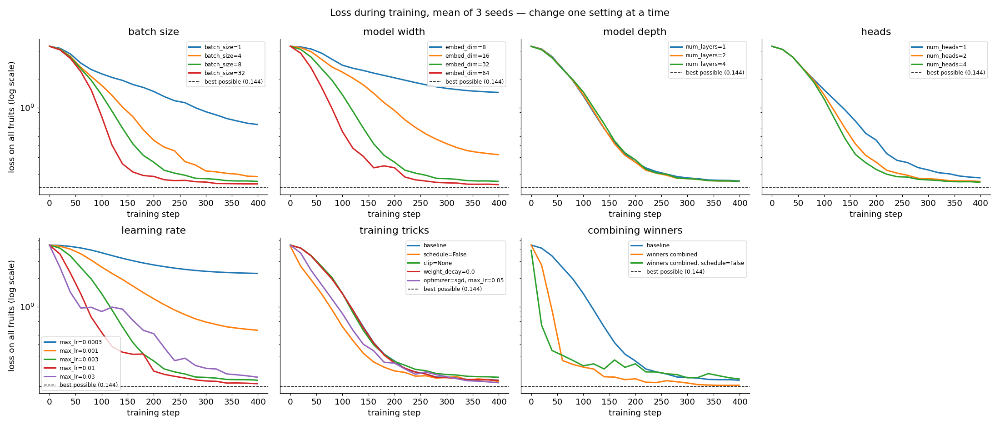

# 26 · Training experiments

> In one sentence: to find out what works, change **one** setting at a time, train a few times with
> different random seeds, and compare the results with metrics — against a baseline and against the best possible score.

## The idea

Some numbers are **learned** by the model (the weights). Others are **chosen by us** before training starts —
they're called **hyperparameters**:

| Hyperparameter | What it controls | Lesson |
|---|---|---|
| batch size | how many words per training step | [23](23_next_token_training.md) |
| `embed_dim`, `num_layers`, `num_heads` | how big the model is | [18](18_multi_head_attention.md), [21](21_transformer_block.md) |
| learning rate | how big each step is | [04](04_gradient_descent.md), [11](11_momentum_and_adam.md) |
| schedule, clipping, weight decay, optimizer | training tricks | [11](11_momentum_and_adam.md), [12](12_training_tricks.md) |

There is no formula that tells you the best values. You find them by **experimenting**. A fair experiment follows a recipe:

1. **Start from a baseline** — our usual settings: batch 8, `embed_dim` 32, 2 layers, 2 heads, learning rate $3 \times 10^{-3}$, AdamW with warmup + cosine schedule, clipping at 1.0.
2. **Change one thing at a time.** If you change two things and it gets better, you don't know which one helped.
3. **Keep the budget fixed.** Every run trains for the same 400 steps.
4. **Repeat with several seeds.** The starting weights and the batches are random, so one run can be lucky. We train every setting 3 times and report the mean $\pm$ standard deviation.
5. **Measure with the same metrics on the same data** — the [metrics from lesson 10](10_metrics.md).
6. **Know the best possible score**, so you know when to stop trying.

## What is the best possible score?

Some next letters are truly ambiguous: after `p` the next letter could be `e` (peach, pear), `l` (plum) or `a` (papaya).
No model can be sure there. The best any model can do is to predict exactly how often each letter follows that prefix
in the data. If $\hat{p}(c \mid \text{prefix})$ is that fraction, the lowest possible loss over all $N$ letters is:

```math
L^{*} = -\frac{1}{N} \sum_{n=1}^{N} \log \hat{p}(c_n \mid \text{prefix}_n)
```

and the best possible accuracy picks the most common next letter for each prefix.

```python
from models.example.experiments import best_possible
print(best_possible())    # loss ≈ 0.144, accuracy 0.91
```

So on our fruit task: **loss 0.144** (perplexity 1.15) and **accuracy 0.91** are perfect scores. A model at 0.91 accuracy can't be improved on accuracy at all.

## What we measure

`evaluate` in [`models/example/train.py`](../models/example/train.py) scores a model on **all** fruits at once:

| Metric | Question it answers |
|---|---|
| loss, perplexity | how sure is the model of the correct next letter? |
| accuracy | how often is its top guess right? |
| hit@3, MRR | is the right letter near the top of its list? |
| **spelling** | give it the first 2 letters (`ba`, `gr`, ...) and let it write greedily: how often does it write a real fruit? |

The last one is a **task metric**: it measures what we actually care about, not a proxy.

## Code

`train` in [`train.py`](../models/example/train.py) takes every setting as a parameter. One experiment is a small function in
[`models/example/experiments.py`](../models/example/experiments.py), simplified:

```python
import statistics
from models.example.train import train

BASELINE = dict(batch_size=8, embed_dim=32, num_layers=2, num_heads=2, max_lr=3e-3,
                schedule=True, optimizer='adamw', weight_decay=0.01, clip=1.0)

def run_sketch(change, seeds=(0, 1, 2), steps=400):
    config = {**BASELINE, **change}                         # baseline + ONE change
    finals = []
    for seed in seeds:                                      # same setting, different luck
        model = train(steps=steps, seed=seed, verbose=False, save_dir=None, **config)
        finals.append(model.history[-1])                    # the metrics after the last step
    return {m: statistics.mean(f[m] for f in finals) for m in ['loss', 'accuracy', 'spelling']}
```

## Try it

A small experiment: does the batch size matter? (One seed each, so it takes only a few seconds.)

```python
from models.example.experiments import run, table

results = [run(dict(batch_size=b), seeds=[0]) for b in (1, 32)]
print(table(results))
# batch_size=1 is far behind: loss ≈ 0.7, and it spells only about 4 in 5 fruits after 400 steps
```

The full study below trains 21 different settings × 3 seeds = 63 runs. Run it with `python -m models.example.experiments`
(about 1.5 minutes on a laptop CPU). The seeds are fixed, so you get the same numbers, except the seconds.

## Results

Loss on all fruits during training, averaged over 3 seeds (dashed line: the best possible loss):



### Batch size

| setting | params | loss | perplexity | accuracy | hit@3 | MRR | spelling | sec/run |
|---|---|---|---|---|---|---|---|---|
| batch_size=1 | 31,456 | 0.667 ± 0.039 | 1.95 | 0.843 | 0.977 | 0.911 | 0.74 | 1.2 |
| batch_size=4 | 31,456 | 0.188 ± 0.005 | 1.21 | 0.910 | 1.000 | 0.952 | 1.00 | 1.3 |
| batch_size=8 | 31,456 | 0.167 ± 0.001 | 1.18 | 0.910 | 1.000 | 0.952 | 1.00 | 1.4 |
| batch_size=32 | 31,456 | 0.157 ± 0.001 | 1.17 | 0.910 | 1.000 | 0.952 | 1.00 | 2.1 |

A bigger batch averages the gradient over more words, so each step points in a better direction.
Batch 1 is so noisy that after 400 steps it still misspells a quarter of the fruits. But bigger batches cost more
time per step (2.1 s vs 1.4 s per run here) — on a large task, that trade-off is the real question.

### Model width (`embed_dim`)

| setting | params | loss | perplexity | accuracy | hit@3 | MRR | spelling | sec/run |
|---|---|---|---|---|---|---|---|---|
| embed_dim=8 | 3,256 | 1.455 ± 0.125 | 4.31 | 0.630 | 0.827 | 0.746 | 0.19 | 1.1 |
| embed_dim=16 | 9,584 | 0.320 ± 0.041 | 1.38 | 0.907 | 1.000 | 0.950 | 1.00 | 1.2 |
| embed_dim=32 | 31,456 | 0.167 ± 0.001 | 1.18 | 0.910 | 1.000 | 0.952 | 1.00 | 1.4 |
| embed_dim=64 | 112,064 | 0.155 ± 0.000 | 1.17 | 0.910 | 1.000 | 0.952 | 1.00 | 1.6 |

With `embed_dim` 8, the model is simply too small to store 20 words: it spells only 19% of them. From 32 on, it fits;
64 is slightly better but has 3.6× as many parameters.

### Model depth (`num_layers`)

| setting | params | loss | perplexity | accuracy | hit@3 | MRR | spelling | sec/run |
|---|---|---|---|---|---|---|---|---|
| num_layers=1 | 18,752 | 0.169 ± 0.001 | 1.18 | 0.910 | 1.000 | 0.952 | 1.00 | 0.8 |
| num_layers=2 | 31,456 | 0.167 ± 0.001 | 1.18 | 0.910 | 1.000 | 0.952 | 1.00 | 1.4 |
| num_layers=4 | 56,864 | 0.167 ± 0.002 | 1.18 | 0.910 | 1.000 | 0.952 | 1.00 | 2.5 |

No difference at all — but 4 layers take 3× as long as 1. To continue a word you mostly need to know *which word it is*,
and one attention layer can already look at every earlier letter. **Bigger is not automatically better; it depends on the task.**

### Attention heads

| setting | params | loss | perplexity | accuracy | hit@3 | MRR | spelling | sec/run |
|---|---|---|---|---|---|---|---|---|
| num_heads=1 | 31,456 | 0.182 ± 0.005 | 1.20 | 0.910 | 1.000 | 0.952 | 1.00 | 1.3 |
| num_heads=2 | 31,456 | 0.167 ± 0.001 | 1.18 | 0.910 | 1.000 | 0.952 | 1.00 | 1.4 |
| num_heads=4 | 31,456 | 0.164 ± 0.001 | 1.18 | 0.910 | 1.000 | 0.952 | 1.00 | 1.3 |

One head learns a little slower than two or four (same number of parameters, see [lesson 18](18_multi_head_attention.md)).

### Learning rate

| setting | params | loss | perplexity | accuracy | hit@3 | MRR | spelling | sec/run |
|---|---|---|---|---|---|---|---|---|
| max_lr=0.0003 | 31,456 | 2.242 ± 0.038 | 9.42 | 0.620 | 0.793 | 0.735 | 0.19 | 1.4 |
| max_lr=0.001 | 31,456 | 0.563 ± 0.023 | 1.76 | 0.907 | 0.997 | 0.949 | 1.00 | 1.4 |
| max_lr=0.003 | 31,456 | 0.167 ± 0.001 | 1.18 | 0.910 | 1.000 | 0.952 | 1.00 | 1.4 |
| max_lr=0.01 | 31,456 | 0.153 ± 0.001 | 1.17 | 0.910 | 1.000 | 0.952 | 1.00 | 1.4 |
| max_lr=0.03 | 31,456 | 0.180 ± 0.030 | 1.20 | 0.897 | 1.000 | 0.944 | 0.93 | 1.4 |

**The most important knob.** $3 \times 10^{-4}$ barely moves in 400 steps; $10^{-2}$ is best; at $3 \times 10^{-2}$ training
becomes unstable: see the bumpy curve, the 30× larger spread between seeds, and the spelling dropping to 0.93.
This is exactly the "too small / good / too big" picture from [lesson 04](04_gradient_descent.md).

### Training tricks

| setting | params | loss | perplexity | accuracy | hit@3 | MRR | spelling | sec/run |
|---|---|---|---|---|---|---|---|---|
| baseline | 31,456 | 0.167 ± 0.001 | 1.18 | 0.910 | 1.000 | 0.952 | 1.00 | 1.4 |
| schedule=False | 31,456 | 0.162 ± 0.004 | 1.18 | 0.910 | 1.000 | 0.952 | 1.00 | 1.4 |
| clip=None | 31,456 | 0.179 ± 0.002 | 1.20 | 0.910 | 1.000 | 0.952 | 1.00 | 1.4 |
| weight_decay=0.0 | 31,456 | 0.166 ± 0.001 | 1.18 | 0.910 | 1.000 | 0.952 | 1.00 | 1.4 |
| optimizer=sgd, max_lr=0.05 | 31,456 | 0.157 ± 0.003 | 1.17 | 0.910 | 1.000 | 0.952 | 1.00 | 1.1 |

On this tiny task, the tricks hardly matter: without clipping it's a bit worse, everything else ends up close.
Without warmup (`schedule=False`) the loss even falls *faster* at the start. The tricks from [lesson 12](12_training_tricks.md)
pay off on big models with long training, where one bad step can ruin hours of work.

### Combining the winners

| setting | params | loss | perplexity | accuracy | hit@3 | MRR | spelling | sec/run |
|---|---|---|---|---|---|---|---|---|
| baseline | 31,456 | 0.167 ± 0.001 | 1.18 | 0.910 | 1.000 | 0.952 | 1.00 | 1.4 |
| batch_size=32, embed_dim=64, num_layers=1, max_lr=0.01 | 62,080 | 0.148 ± 0.001 | 1.16 | 0.910 | 1.000 | 0.952 | 1.00 | 1.5 |
| batch_size=32, embed_dim=64, num_layers=1, max_lr=0.01, schedule=False | 62,080 | 0.172 ± 0.022 | 1.19 | 0.903 | 1.000 | 0.948 | 0.98 | 1.5 |

Putting the winners together (batch 32, `embed_dim` 64, 1 layer, learning rate $10^{-2}$) gets within 0.004 of the best possible loss —
in the same time as the baseline, because the single layer saves what the bigger batch and width cost.

But adding one more "winner" — no schedule, which looked fine on its own — makes it **worse** and less stable (± 0.022).
With the higher learning rate, warmup and decay suddenly matter. **Settings interact**, so always test the final combination too.

## What we learned

- On this task the best setup is: **batch 32, `embed_dim` 64, 1 layer, learning rate $10^{-2}$, with warmup and cosine decay.**
- The **learning rate** mattered most, then **model width** and **batch size**. Depth and the tricks hardly mattered here.
- **Accuracy and hit@3 were useless for choosing**: almost every run reached the maximum (0.91 and 1.0). Loss, perplexity
  and spelling still showed differences. Choose metrics that still have room to move.

## Check yourself

1. Why train every setting with 3 seeds instead of 1?
2. Two runs end with accuracy 0.910 and loss 0.167 vs 0.153. Which is better, and how do you know?
3. A friend changes the batch size *and* the learning rate at the same time, and the loss improves. What can they conclude?

<details><summary>Answers</summary>

1. Each run has random starting weights and random batches. With one seed, a small difference may just be luck.
   The ± column shows how big that luck is: differences smaller than it don't mean much.
2. The one with loss 0.153 — closer to the best possible 0.144. Accuracy can't tell them apart because both are already at the maximum 0.91.
3. Only that the *combination* helps — not which of the two changes did it, or whether one of them even hurt.
</details>

<details><summary>Going deeper: how real projects search, and what we skipped</summary>

- **Search strategies.** We changed one setting at a time around a baseline. *Grid search* tries every combination
  (it explodes quickly: 5 settings × 4 values = 1,024 runs). *Random search* samples random combinations and is often
  better for the same budget. Real projects also tune on a small model first, then scale up.
- **Fixed steps vs. fixed time.** We gave every run the same number of steps. Bigger batches and models cost more per step,
  so with a fixed *time* budget the ranking can change. The "seconds per run" column lets you check.
- **A validation set.** Our fruit task is pure memorisation, so we evaluate on the training words themselves. In real work, you always
  hold back data the model never trains on, and compare settings on *that* — otherwise you reward memorising instead of learning.
- **Scaling laws.** For large language models, loss falls predictably as model size, data and compute grow together
  (Kaplan et al., 2020; Hoffmann et al., 2022). Experiments like these, done at many sizes, are how such laws were found.
</details>

---
[Course map](../README.md) · Prev: [25](25_train_end_to_end.md) · Next: [27 · MyGPT, the complete picture](27_mygpt_complete_picture.md)
