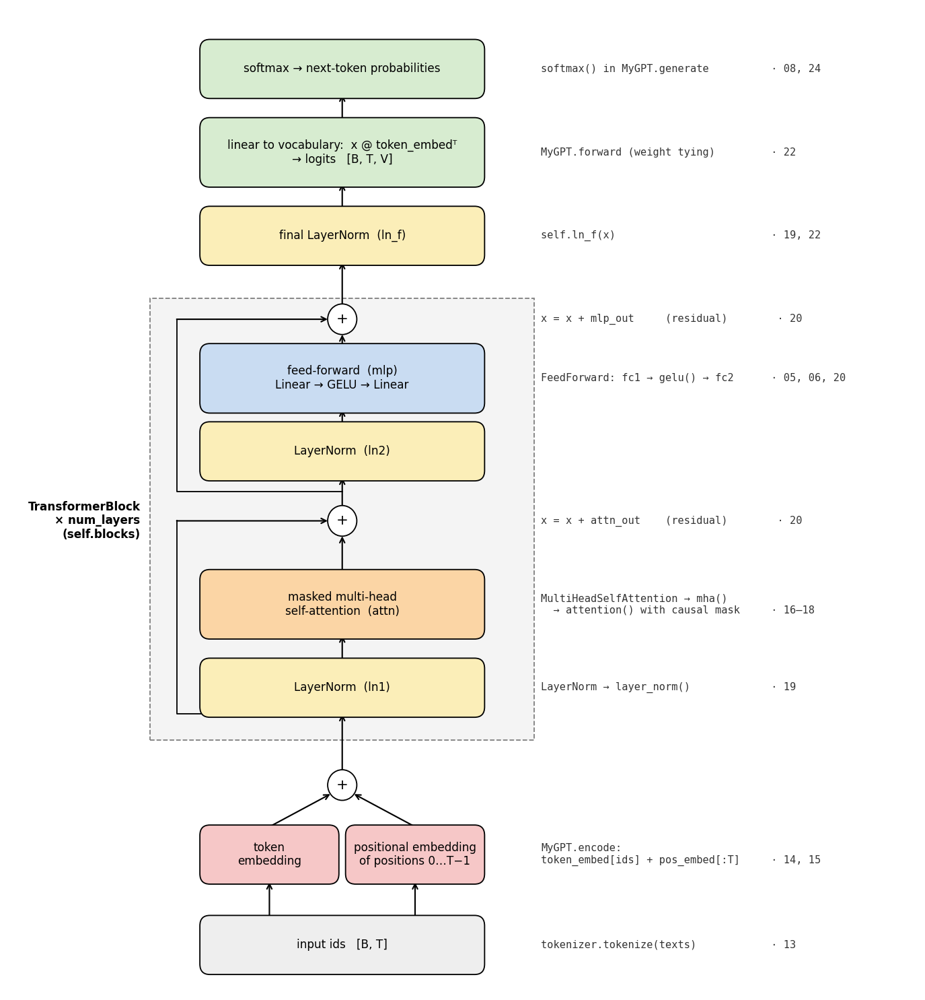

# 27 · MyGPT, the complete picture

**Level: 🟡 Intermediate**

> In one sentence: our `MyGPT` is the right-hand half of the famous transformer diagram — every box
> in that picture is a few lines of code you've already written.

## The famous picture

Almost every explanation of transformers shows the same figure: **Figure 1** of the paper that introduced them,

> Vaswani, A., Shazeer, N., Parmar, N., Uszkoreit, J., Jones, L., Gomez, A. N., Kaiser, Ł., & Polosukhin, I. (2017).
> *Attention Is All You Need*. NeurIPS 2017. [arXiv:1706.03762](https://arxiv.org/abs/1706.03762) —
> **[open Figure 1](https://arxiv.org/html/1706.03762v7#S3.F1)** ("The Transformer - model architecture").

Open it next to this lesson. (We link to the figure rather than copying it, since it belongs to the paper's authors.)
It has **two towers**, because the paper was about *translation*:

- **left tower — the encoder**: reads the whole input sentence (say, in German). Inputs → Input Embedding ⊕ Positional
  Encoding → $N\times$ [Multi-Head Attention, Add & Norm, Feed Forward, Add & Norm].
- **right tower — the decoder**: writes the output sentence (in English) one token at a time. Outputs (shifted right)
  → Output Embedding ⊕ Positional Encoding → $N\times$ [**Masked** Multi-Head Attention, Add & Norm, Multi-Head Attention
  over the encoder's output, Add & Norm, Feed Forward, Add & Norm] → Linear → Softmax → Output Probabilities.

**GPT keeps only the right tower.** There is no input sentence to translate, just text to continue — so the
encoder goes away, and with it the middle attention that looks at the encoder. What's left is a stack of
"masked attention + feed-forward" blocks: exactly our [`TransformerBlock`](21_transformer_block.md).

## Our version, box by box

Here is `MyGPT`, drawn the same way (bottom to top), with the code that implements each box and the lesson that explains it:



| Box in Figure 1 (right tower) | In `MyGPT` | Code | Lesson | Same or different? |
|---|---|---|---|---|
| Outputs (shifted right) | `input_ids` | `tokenizer.tokenize`, `get_train_batch` | [13](13_tokenizer.md), [23](23_next_token_training.md) | same idea: input = text, target = text shifted by one |
| Output Embedding | `token_embed` | `MyGPT.encode` | [14](14_token_embeddings.md) | same |
| Positional Encoding ⊕ | `pos_embed` | `MyGPT.encode` | [15](15_positional_embeddings.md) | **learned** table (like GPT-2), not sine waves |
| Masked Multi-Head Attention | `attn` | `MultiHeadSelfAttention` → `mha` → `attention` | [16](16_attention.md)–[18](18_multi_head_attention.md) | same |
| Multi-Head Attention over the encoder | — | — | — | **removed**: there is no encoder |
| Feed Forward | `mlp` | `FeedForward` | [20](20_residual_and_feed_forward.md) | GELU instead of ReLU |
| Add & Norm | `x + ...`, `ln1`, `ln2` | `TransformerBlock.forward` | [19](19_layer_norm.md), [20](20_residual_and_feed_forward.md) | **pre-norm**: normalise *before* each sub-layer, plus one final `ln_f` |
| $N\times$ | `num_layers` | `self.blocks` | [21](21_transformer_block.md) | paper: $N = 6$; ours: 2 |
| Linear | `x @ token_embed.T` | `MyGPT.forward` | [22](22_assemble_gpt.md) | same — the paper also reuses the embedding matrix here |
| Softmax → Output Probabilities | `softmax`, `cross_entropy` | `MyGPT.generate`, `train.py` | [08](08_softmax.md), [09](09_cross_entropy.md), [24](24_generation.md) | same |

In formulas, one forward pass of `MyGPT` with $L$ blocks is:

```math
\begin{aligned}
x_0 &= \text{TokenEmbed}(\text{ids}) + \text{PosEmbed}(0, \dots, T-1) \cr
x &\leftarrow x + \text{Attention}(\text{LayerNorm}_1(x)) \quad \text{and} \quad x \leftarrow x + \text{FFN}(\text{LayerNorm}_2(x)) \qquad \text{(repeat for each of the } L \text{ blocks)} \cr
\text{logits} &= \text{LayerNorm}_f(x) \, E_{\text{token}}^\top \cr
P(\text{next token}) &= \text{softmax}(\text{logits})
\end{aligned}
```

## Code

The whole model, from [`models/example/model.py`](../models/example/model.py) (shortened: saving, configs and
`generate` are left out — see [lesson 24](24_generation.md) for `generate`):

```python
import torch
from modules.module import Module, Parameter, ModuleList, TransformerBlock, LayerNorm
from models.example.tokenizer import MyGptTokenizer

class MyGPTSketch(Module):
    def __init__(self, max_seq_length, embed_dim, num_layers, num_heads):
        self.tokenizer = MyGptTokenizer()
        V = self.tokenizer.vocab_size()
        self.token_embed = Parameter(torch.randn(V, embed_dim) * 0.02)               # Output Embedding
        self.pos_embed = Parameter(torch.randn(max_seq_length, embed_dim) * 0.02)    # Positional Encoding
        self.blocks = ModuleList([TransformerBlock(embed_dim, num_heads)             # N× blocks
                                  for _ in range(num_layers)])
        self.ln_f = LayerNorm(embed_dim)                                             # final norm (pre-norm style)

    def _param_keys(self): return 'token_embed', 'pos_embed', 'blocks', 'ln_f'
    def _config_keys(self): return self._param_keys()

    def forward(self, ids):                                    # ids: [B, T]
        T = ids.shape[1]
        x = self.token_embed[ids] + self.pos_embed[:T]         # [B, T, E]
        x = self.blocks(x)                                     # [B, T, E]
        x = self.ln_f(x)                                       # [B, T, E]
        return x @ self.token_embed.T                          # Linear -> logits [B, T, V]
```

## Try it

**Every learnable number, by name.** The names follow the boxes in the figure:

```python
from models.example.model import MyGPT

torch.manual_seed(0)
model = MyGPT(max_seq_length=100, embed_dim=32, num_layers=2, num_heads=2)
for name, p in model.named_parameters():
    if 'TransformerBlock_2' not in name:                       # block 2 has the same shapes as block 1
        print(f'{name:42} {tuple(p.shape)}')
```

**Where the parameters live:**

```python
def count(prefix):
    return sum(p.numel() for name, p in model.named_parameters() if name.startswith(prefix))

for part in ['token_embed', 'pos_embed', 'blocks.TransformerBlock_1.attn', 'blocks.TransformerBlock_1.mlp',
             'blocks.TransformerBlock_1.ln', 'blocks', 'ln_f', '']:
    print(f'{part or "total":32} {count(part):6d}')
# token_embed 2784 · pos_embed 3200 · attn 4224 · mlp 8352 · ln 128 · blocks 25408 · ln_f 64 · total 31456
```

The feed-forward layer holds twice as many weights as attention — true for real GPTs too.

**Walk through the figure by hand**, box by box, and check we get exactly what `model(ids)` returns:

```python
ids, _ = model.tokenizer.tokenize(['banan'], add_eos=False)    # [1, 5]

x = model.encode(ids)                                          # embedding ⊕ positions
print('after embeddings ', tuple(x.shape))
for block in model.blocks.modules:
    x = x + block.attn(block.ln1(x))                           # masked attention, Add
    x = x + block.mlp(block.ln2(x))                            # feed forward, Add
    print('after a block    ', tuple(x.shape))
logits = model.ln_f(x) @ model.token_embed.T                   # final norm, Linear
print('logits           ', tuple(logits.shape))                # [1, 5, 87]: a score for every token, at every position

print(torch.allclose(logits, model(ids)))                      # True
```

## Check yourself

1. Which boxes would you add to `MyGPT` to get the paper's full translation model back?
2. The figure has $N\times$ next to the decoder. Which line of `MyGPT` is that?

<details><summary>Answers</summary>

1. The whole left tower (an encoder: a stack of blocks with **un**masked attention, reading the source sentence),
   plus a second attention in each decoder block whose keys and values come from the encoder's output ("cross-attention").
2. `self.blocks = ModuleList([TransformerBlock(...) for _ in range(num_layers)])` — and `num_layers` is $N$.
</details>

<details><summary>Going deeper: our sizes vs. the paper, GPT-2 and modern LLMs</summary>

| | layers $N$ | $E$ ($d_{\text{model}}$) | heads | FFN width | vocabulary | max length | parameters |
|---|---|---|---|---|---|---|---|
| **MyGPT** | 2 | 32 | 2 | 128 | 87 characters | 100 | 31 thousand |
| Transformer base (2017) | 6 + 6 | 512 | 8 | 2048 | 37,000 subwords | — | 65 million |
| GPT-2 small (2019) | 12 | 768 | 12 | 3072 | 50,257 subwords | 1024 | 124 million |

Newer LLMs (e.g. LLaMA) still use this decoder-only design, with a few parts swapped:
**RMSNorm** instead of LayerNorm ([lesson 19](19_layer_norm.md)), **RoPE** instead of a position table
([lesson 15](15_positional_embeddings.md)), a gated feed-forward layer ("SwiGLU"), no biases, and many more layers.
The picture you now understand is still the picture.
</details>

---
[Course map](../README.md) · Prev: [26](26_training_experiments.md)
